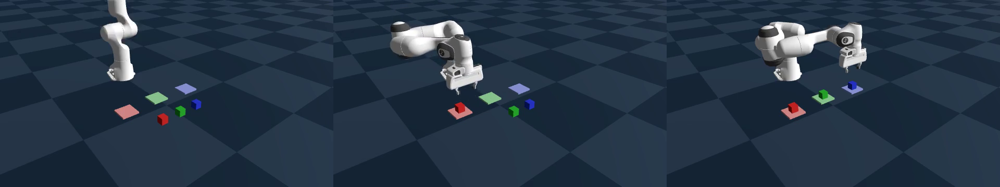
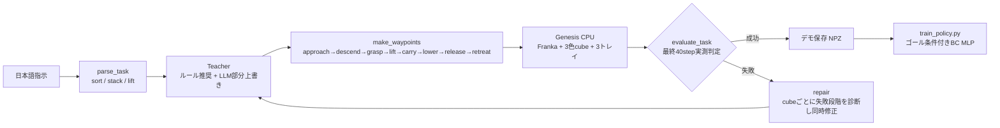

# 日本語指示で動く Franka の「お手本生成 → 自動判定 → 自動修正 → 模倣学習」パイプライン

Physical AI 講座 2026 応用編1 最終課題（テーマA）の提出リポジトリです（Omnicampus アカウント名: `takeyasu`）。  
日本語の作業指示を **Teacher（ルール推奨＋LLM部分上書き差し込み口）** が Waypoint プログラムのパラメータに変換し、**Genesis（CPU）上の 7自由度 Franka Emika Panda** で実行します。軌道の物理実測値から成功を厳密に判定し、失敗時は失敗段階を自動診断して同時修復します。さらに、自動検証を通過した成功デモ軌道を **DART型ノイズ注入** で200エピソード収集し、ゴール条件付き模倣学習方策（Behavior Cloning MLP）を学習して Genesis 閉ループ評価で **成功率 100%（仕分け 5/5・積み重ね 5/5）** を達成しました。

- **デモ動画（YouTube 2分00秒）**: `PAI最終課題_takeyasu`（YouTube限定公開URLはアップロード後に追記）
- **ローカル生成済み動画素材**:
  - `runs/videos/sort_normal.mp4`（3色キューブ仕分け・初回成功）
  - `runs/videos/stack_normal.mp4`（青キューブを赤キューブの上に積む・初回成功）
  - `runs/videos/sort_auto_repair.mp4`（`bad_start` 1回目空振り FAIL → 実測診断 → 2回目で3色同時修復し PASS）
  - `runs/videos/stack_auto_repair.mp4`（`place_bias` 1回目配置ずれ落下 FAIL → 2回目で実測誤差補正しスタック PASS）
  - `results/policy_dart/closed_loop_ep0.mp4`（学習済み1.9万パラメータMLP方策による未知ランダム配置の閉ループ実行映像）



## できること

| タスク | 日本語指示の例 | 成功条件（最後の0.4秒＝40ステップの全フレームで同時成立が必要） |
|---|---|---|
| 色ごとの仕分け (`sort`) | 「赤・緑・青のキューブを同じ色のトレイに仕分けて」 | 各 cube が対応トレイ中心から 3cm 以内でトレイ上に静止（速度 < 0.05m/s）し、グリッパが離れている（hand-cube距離 ≥ 0.14m）。対象外の cube を動かしていない（≤ 1.5cm） |
| 積み重ね (`stack`) | 「青いキューブを赤いキューブの上に積んで」 | 上下の cube の水平ずれ ≤ 12mm、高さ差 0.04±0.006m、土台 cube の移動 ≤ 1.5cm、グリッパが離れて静止 |
| 持ち上げ (`lift`) | 「緑のキューブを高さ25cmまで持ち上げて」 | 目標高さ ±2.5cm、hand と cube の距離 ≤ 0.14m |

- 「ゆっくり／慎重に／丁寧に」と指示すると、補間区間ステップ数が 1.35 倍に延長され、実際に移動速度が低下します。
- 否定文（「〜しないで」）、未対応の色、同じ cube を自分の上に積む指示などは、実行前に安全ガードで拒否します。

## システム構成と自動修復の仕組み



**自動修正のルール**（`tasks.repair`）: 失敗した cube ごとに、軌道の物理実測値から「どの段階で失敗したか」を診断し、1回の反復で複数 cube・複数パラメータを同時に修復します（最大6試行、同一パラメータで2回連続失敗した場合は `no_progress` で早期停止）。

| 失敗段階（実測による診断） | 自動修復アクション |
|---|---|
| `missed_grasp`（把持位置ずれ / リフト時に初期高さ+5cm未満かつ指が全閉） | 把持直前（approach終了時）に実測した cube 位置に把持 XY を合わせ、高さオフセット `grasp_dz` を 0 に戻す（力不足も同時に補正） |
| `weak_grasp`（指は cube に触れたが持ち上がらない） | 把持力 `F` を2倍に強化し、把持ステップ数を延ばす |
| `dropped_in_transport`（一度持ち上がったが搬送中に落下） | 把持力 `F` を強化し、搬送区間のステップ数を増やして減速する |
| `place_error`（リリース直前の目標誤差過大または転倒） | リリース直前の実測誤差 `(Δx, Δy)` の分だけ次回配置目標を差し引いて補正（転倒時はリリース高さを下げゆっくり離す） |
| `lifted`（持ち上げ高さの誤差） | 実測高さ誤差で目標高さを補正する |

**LLM 接続差し込み口**: `MultiTeacher(proposer=callable)` に「プロンプト文字列 → 文字列/辞書」を返す関数を渡すと、LLM の JSON 提案でルール推奨値を**部分的に上書き**します。` ```json ` フェンスや前置きの文章があっても最初の JSON オブジェクトを抽出し、範囲外の値・未知のキー・タイムアウト等の例外発生時は決定論的ルール案へ安全にフォールバックします（本リポジトリの実験結果・動画はすべて再現性の高いオフラインルール＋BC方策で取得しています）。

## 模倣学習方策（Behavior Cloning）と検証結果

### 1. お手本生成・自動修復ループの実物理 E2E 検証（`VALIDATION_IMPROVED.md`）

Genesis 1.4.5（CPU, `dt=0.01s, substeps=4`）上で全9ケース＋上限到達テストを実行し、**全ケース PASS（9/9 PASS、単体テスト 26/26 PASS）** を確認しました。また、不要な毎ステップ RGB カメラ描画を間引くことで、E2E 実行速度を従来の約 24 steps/s から **547〜590 steps/s（約23倍）** に高速化しています。

| ケース | 日本語指示 | モード | 配置 | 試行数 | 最終XY誤差 [mm] | 結果 | 自動修復内容 |
|---|---|---|---|---:|---:|---|---|
| `sort_normal` | 赤・緑・青のキューブを同じ色のトレイに仕分けて | `normal` | 既定 | 1 | R:1.9, G:0.8, B:0.6 | **PASS** | 初回成功 |
| `stack_normal` | 青いキューブを赤いキューブの上に積んで | `normal` | 既定 | 1 | 1.6（積重ずれ 1.6） | **PASS** | 初回成功 |
| `lift_green_25cm` | 緑のキューブを高さ25cmまで持ち上げて | `normal` | 既定 | 1 | 2.7（高さ誤差 -2.1） | **PASS** | 初回成功 |
| `sort_auto_repair` | 色ごとに仕分けして | `bad_start` | 既定 | **2** | R:1.9, G:0.8, B:0.6 | **PASS** | 3色同時に実測位置からXY・高さ・把持力を修復 |
| `stack_auto_repair` | 青いキューブを赤いキューブの上に積んで | `place_bias` | 既定 | **2** | 2.1（積重ずれ 2.1） | **PASS** | リリース直前の実測誤差 `(-41mm, 0mm)` を差し引き補正 |
| `stack_bad_start_random` | 緑のキューブを青いキューブの上に積み重ねて | `bad_start` | random(11) | **2** | 0.9（積重ずれ 0.9） | **PASS** | 実測cube位置から把持XY・高さ・力を修復 |
| `sort_perturbed_random` | 色ごとに仕分けして | `perturbed` | random(12) | **3** | R:28.9, G:2.4, B:24.6 | **PASS** | 2回目で3色把持修復 → 3回目で緑の配置ずれ補正 |
| `sort_careful_random` | ゆっくり丁寧に色ごとに仕分けて | `normal` | random(13) | 1 | R:1.7, G:0.9, B:2.0 | **PASS** | 補間1.35倍延長（2640 steps）で初回成功 |
| `lift_original_task` | 赤いブロックを掴んで高さ30cmまで持ち上げて | `normal` | 既定 | 1 | 2.9（高さ誤差 -2.3） | **PASS** | 初回成功 |

### 2. DARTデモ収集・模倣学習（`results/policy_dart/report.json`）

- **データ収集**: ランダム配置 200 エピソード（仕分け100＋積み重ね100、計300 primitive、train 168,301 steps / val 42,322 steps）を、実行指令にガウスノイズ（$\sigma=2\text{cm}$）と区間ステップ長ジッター（$\pm 20\%$）を加える **DART 型ノイズ注入** で自動収集しました。
- **モデル設計**: 15次元観測（hand座標、指幅、cube−hand、goal−hand、goal−cube、releaseフラグ、位相 phase）から4次元行動（$\Delta x, \Delta y, \Delta z$, グリッパ開閉確率）を出力する **2層MLP（隠れ層128、19,076パラメータ）**。閉ループ実行時の把持遅れを防ぐため、**グリッパ開閉ラベルの20ステップ先読み（`grip_lookahead=20`）** を導入しています。

| 評価区分 | モデル / タスク | Δxyz RMSE [mm] | Δxyz MAE [mm] | グリッパ開閉正解率 | Genesis 閉ループ成功率（未知配置 seed=999） |
|---|---|---:|---:|---:|---|
| オフライン検証 (val 60 primitives) | **MLP Policy（提案・19,076 params）** | **7.77** | **4.50** | **98.5%** | - |
| オフライン検証 (val 60 primitives) | Linear Ridge Baseline | 14.15 | 9.99 | 93.3% | - |
| オフライン検証 (val 60 primitives) | Zero-Action Baseline | 21.55 | 13.27 | 50.8% | - |
| **Genesis 閉ループ評価** | **3色仕分け（`sort`: 3個連続搬送）** | - | - | - | **5 / 5 エピソード成功（100% / 15/15 cubes）** |
| **Genesis 閉ループ評価** | **積み重ね（`stack`: 2個スタック）** | - | - | - | **5 / 5 エピソード成功（100% / 5/5 stacks）** |

## 使い方

```bash
python -m venv .venv && .venv/bin/pip install -r requirements.txt

# 単体テスト（物理なしの運動学FakeSim＋Genesisスモーク1件）
.venv/bin/python -m unittest -v test_improved
PAI_SKIP_GENESIS=1 .venv/bin/python -m unittest test_improved   # 物理なし高速実行（約2秒）

# 1タスク実行（--mode bad_start / place_bias / perturbed で自動修正を確認、--video でmp4保存）
.venv/bin/python multi_pipeline.py run '赤・緑・青のキューブを同じ色のトレイに仕分けて' --video runs/videos/sort.mp4
.venv/bin/python multi_pipeline.py run '青いキューブを赤いキューブの上に積んで' --mode place_bias

# デモ収集（DARTノイズ＋時間ランダム化）→ 方策学習 → Genesis閉ループ評価
.venv/bin/python multi_pipeline.py collect --episodes 200 --seed 1000 --mode timing_jitter --noise-std 0.02 --output-dir data/demos_dart
.venv/bin/python train_policy.py --demos data/demos_dart --out results/policy_dart --closed-loop 5 --video results/policy_dart/closed_loop_ep0.mp4

# 実物理E2E検証（VALIDATION_IMPROVED.md を再生成）
.venv/bin/python validate_improved.py --videos
```

## ファイル構成

| ファイル | 内容 |
|---|---|
| `tasks.py` | 日本語指示解析、配置、Waypoint生成、厳密成功判定、失敗段階の診断、同時自動修復、Teacher（Genesis 非依存） |
| `sim.py` | Genesis scene（Franka＋3色 cube＋3トレイ）、連続補間 IK 制御、rollout、DART ノイズ注入 |
| `multi_pipeline.py` | 自動修正ループ（最大6試行）、成果物保存、デモ収集 CLI |
| `train_policy.py` | NPZ → データセット変換、グリッパ先読み付き MLP / 線形 BC 学習、オフライン評価、Genesis 閉ループ評価 |
| `test_improved.py` | 単体テスト（運動学 FakeSim で自動修正ループ・方策学習まで検証）＋実物理スモークテスト |
| `validate_improved.py` | 実物理 E2E 検証スイート（9ケース＋上限到達テスト）とレポート自動生成 |
| `pipeline.py` / `test_pipeline.py` | 単一ブロック持ち上げベースライン版とその E2E テスト |
| `results/policy_dart/` | 学習済み MLP 方策（`policy.pt`）、評価レポート（`report.json`）、閉ループ実行動画（`closed_loop_ep0.mp4`） |
| `runs/videos/` | E2E 検証で生成された代表デモ動画（`sort_normal.mp4`, `stack_normal.mp4`, `sort_auto_repair.mp4`, `stack_auto_repair.mp4`） |

## ライセンス

本リポジトリのコードは MIT License の下で公開します。シミュレーション環境として使用する Genesis および Franka Emika Panda MJCF モデルはそれぞれの配布元ライセンスに従います。
